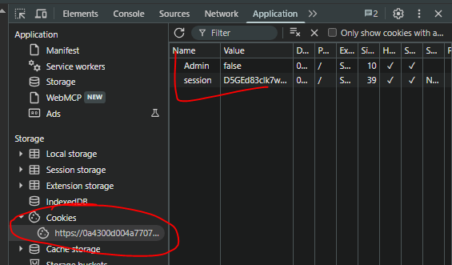

# Access Control

Access Control (Controle de Acesso) é o conjunto de mecanismos que determina quem pode acessar quais recursos e executar quais ações dentro de uma aplicação, apoiando-se nos princípios de autenticação (quem é o usuário) e autorização (o que ele pode fazer). Vulnerabilidades surgem quando essas verificações são ausentes, inconsistentes ou dependem de dados controláveis pelo cliente (IDs, parâmetros, cookies, _headers_), permitindo falhas como IDOR e **escalonamento de privilégios** (vertical ou horizontal), como exemplificado adiante. A validação deve ocorrer sempre no lado do servidor, de forma centralizada e a cada requisição, *sem muita fé* em controles de interface nem em "segurança por obscuridade"¹.

### 📚 Referências e/ou leituras recomendadas:

-   [OWASP Top 10:2025 – A01: Broken Access Control](https://owasp.org/Top10/2025/A01_2025-Broken_Access_Control/)
-   [PortSwigger Web Security Academy – Access control vulnerabilities and privilege escalation](https://portswigger.net/web-security/access-control)
-   [PortSwigger Web Security Academy – Insecure direct object references (IDOR)](https://portswigger.net/web-security/access-control/idor)
-   [OWASP Cheat Sheet – Insecure Direct Object Reference Prevention](https://cheatsheetseries.owasp.org/cheatsheets/Insecure_Direct_Object_Reference_Prevention_Cheat_Sheet.html)
-   [MITRE CWE-284: Improper Access Control](https://cwe.mitre.org/data/definitions/284.html)
-   [MITRE CWE-656: Reliance on Security Through Obscurity](https://cwe.mitre.org/data/definitions/656.html)

---

## Lab 1: Unprotected admin functionality

> **Objetivo:** acessar o painel de administração e deletar o usuário `carlos`.

Nada de muito interessante no código-fonte dessa vez: nenhum comentário, nenhum vestígio do que precisamos fazer ou acessar, sem pistas, a priori. Mas há um lugar em que, geralmente, podemos encontrar alguma coisa: o `/robots.txt`!²

E é no `/robots.txt` que encontramos isto:

```
User-agent: *
Disallow: /administrator-panel

```

Com acesso irrestrito ao painel de administração, deletamos, sem dificuldade, a conta do pobre Carlos.

O primeiro desafio já foi!

(E, é claro, em `/my-account` testei algumas credenciais, como `admin:admin` ou `administrator:administrator`. Sem sucesso, rs.)

## Lab 2: Unprotected admin functionality with unpredictable URL

> **Objetivo:** acessar o painel de administração e deletar o usuário `carlos`.

Após uma rápida análise do código-fonte, encontramos o seguinte script, que contém o endereço do painel de administração:

```javascript
var isAdmin = false;
if (isAdmin) {
   var topLinksTag = document.getElementsByClassName("top-links")[0];
   var adminPanelTag = document.createElement('a');
   adminPanelTag.setAttribute('href', '/admin-35a5zr');
   adminPanelTag.innerText = 'Admin panel';
   topLinksTag.append(adminPanelTag);
   var pTag = document.createElement('p');
   pTag.innerText = '|';
   topLinksTag.appendChild(pTag);
}

```

Vê-se que o script é entregue a todos, independentemente do valor de `isAdmin`: exposto (o endereço) a qualquer um que leia o código-fonte.

Mais uma vez: _user deleted successfully_! Diferentemente do primeiro desafio, aqui o painel estava protegido por alguma obscuridade: com alguma segurança já que possuía caracteres aleatórios depois do `/admin-`. Embora segurança, aqui, seja uma palavra muito forte (veja a primeira nota de rodapé).

## Lab 3: User role controlled by request parameter

> **Objetivo:** o mesmo: acessar o painel de administração e deletar o usuário `carlos`.

Bem, agora temos um `/admin` acessível e algumas credenciais de acesso, como `wiener:peter` e `administrator:administrator` — esta última, com os mesmos privilégios da primeira. Também sabemos que os cookies, aqui, podem ser modificados. Tentativas de acesso direto a `/admin`, `/administrator` ou semelhantes (_forced browsing_) não tiveram sucesso.

Aos cookies, então! 🍪



Ao alterar `Admin=false` para `Admin=true`, logados na conta de Wiener, temos acesso ao painel de administração. Mais privilégios com uma simples alteração de cookie. Concluímos este desafio.

Os cookies podem ser facilmente vistos e alterados a partir das ferramentas de desenvolvedor de qualquer navegador, de extensões como o Cookie-Editor ou de ferramentas como o [Burp Suite](https://portswigger.net/burp) e o [Caido](https://www.caido.io/).

## Lab 4: User ID controlled by request parameter, with unpredictable user IDs

> **Objetivo:** achar o _Globally Unique Identifier_ (GUID) do usuário `carlos`, logar em sua conta e submeter sua chave de API.

Como primeiro passo, logamos na conta do usuário `wiener`, o que nos dá acesso ao seu GUID e à sua chave de API: `/my-account?id=9a12dc1d-...` e `nO16Z0WBlVww...`, respectivamente.

Encontrar o GUID de Wiener na URL é um belo indicativo de que o mesmo ocorrerá ao logar na conta de Carlos. O problema é que ainda não temos suas credenciais de acesso.

Dessa vez, a página inicial da aplicação exibe diversas publicações, cada qual com conteúdo, comentários e autores diferentes (Wiener, Carlos, Administrator...), todas com GUIDs.

Ao trocar o GUID de Wiener pelo de Administrator, temos os mesmos níveis de acesso. Trocando o de Administrator pelo GUID de Carlos, encontramos o que procurávamos: sua chave de API!

## Lab 5: User ID controlled by request parameter with password disclosure

> **Objetivo:** encontrar a senha do usuário `administrator` e deletar a conta de Carlos.

Ao logar na conta de Wiener, uma mudança simples no parâmetro `id` da URL (`/my-account?id=wiener` > `?id=administrator`) foi suficiente para nos dar acesso às credenciais do administrador. Mas apenas às credenciais, já que a sessão ainda pertencia a Wiener, isto é, ainda estávamos logados como esse usuário.

```html
<input required type="hidden" name="csrf" value="">
<input required type=password name=password value='2enfyg...'/>
<button class='button' type='submit'> Update password </button>

```

Ao logar como `administrator:xxqtl10...`, vemos um link para o painel de administração. Nele, o usuário `carlos` é deletado, mais uma vez. ☠️☠️☠️

Último desafio desta seção concluído.

---

¹ Segurança por obscuridade é a prática de proteger um sistema ocultando seus detalhes (códigos, estruturas, _endpoints_) em vez de usar **controles de segurança reais, mais robustos**. Informações que, dessa forma, são descobertas por enumeração, engenharia reversa, vazamentos, etc. (veja [CWE-656](https://cwe.mitre.org/data/definitions/656.html))

² O `robots.txt` é um arquivo na raiz do domínio que instrui crawlers sobre quais caminhos não devem ser indexados ou rastreados. Na prática, esse é um mecanismo, uma convenção entre bots que por vezes, acaba revelando caminhos mais ou menos sensíveis ou que alguém não gostaria que fossem vistos ou indexados por qualquer buscador como o Google.
